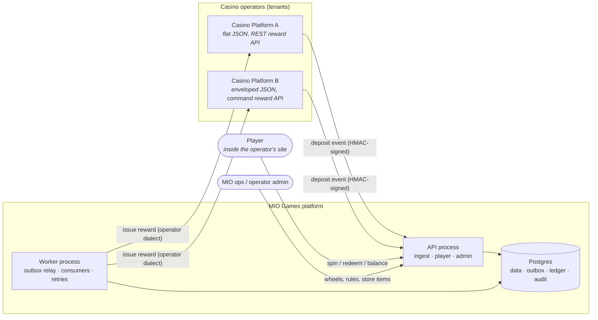
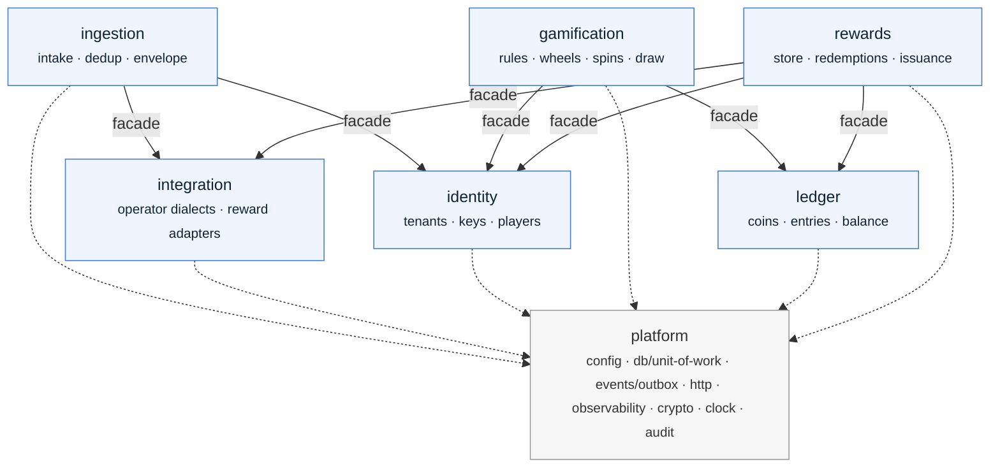
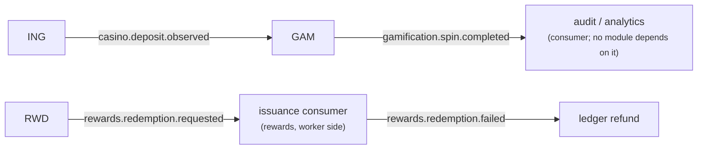
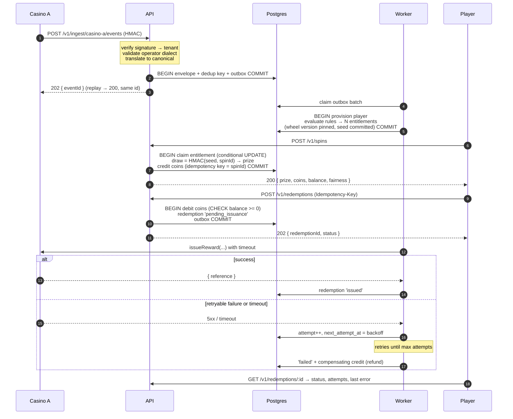
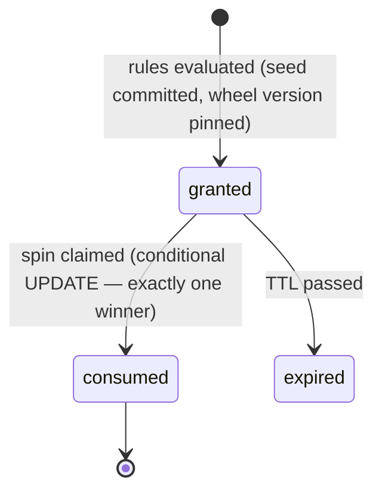
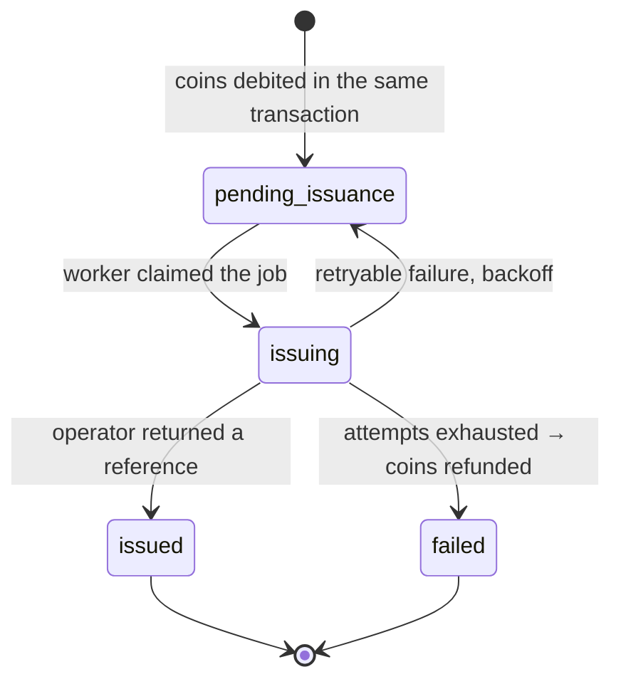

# Diagrams

All diagrams are Mermaid, so they render on GitHub and stay reviewable in a diff.

## Context — who talks to whom

## Module map — the hexagons and the only legal edges

The linter enforces every arrow here and forbids every arrow that is not here
(`eslint.config.mjs`, rule `boundaries/dependencies`, `default: 'disallow'`).

Note what is **missing**: nothing points at `ingestion` or `rewards`, and `ledger` points at
nobody. The ledger is a leaf on purpose — it must never need to ask why a coin moved, because a
module that can be called from everywhere and calls nobody is a module whose invariants you can
actually prove.

Asynchronous edges do not appear above, because they are not imports. They are events:

## Sequence — deposit to issued reward

## State machines — where the money-shaped invariants live

Two rules read straight off these diagrams:

- An entitlement has exactly one transition out of `granted` into `consumed`, and it is a
  conditional `UPDATE ... WHERE state = 'granted'`. Concurrency is settled by the database, not
  by an application-level check-then-act.
- `failed` is never terminal for the player's balance: leaving `issuing` without a reference
  refunds. The redemption and the refund are one transaction, keyed on the redemption id, so a
  worker that dies mid-refund retries into the same idempotency key instead of paying twice.
